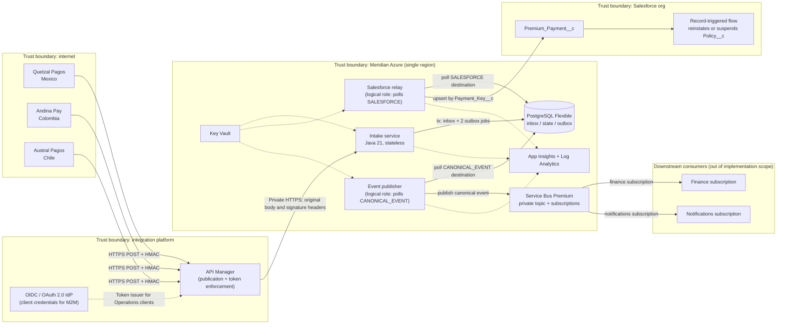

# Premium Payment Notifications — Solution Design

> Status: **documentary closure of Part A for review** (2026-11-21). This is not a claim of legal
> compliance, implementation readiness or completion of Parts B–F; A2 and A6 remain open.
> Sections marked `PENDING` are open decisions, not oversights.
> Related ADRs: `docs/adr/0001-salesforce-integration.md` (Accepted), `docs/adr/0002-stack-and-datastore.md` (Accepted, amended 2026-11-21).
>
> **Target vs. demonstration:** This document describes the production target for all three
> countries. The local Java demonstration uses environment-provided secrets and JDBC PostgreSQL
> (or explicitly opted-in volatile storage), a recording broker and simulated Salesforce. It
> exercises the flow locally, not production adapters, throughput or SLOs. The optional local
> terminal console is a way to explore the demo, not the production Operations identity boundary.

## 1. Context

### 1.1 Scope

Meridian Mutual sells life, auto and home insurance in Mexico, Colombia and Chile from a single
Salesforce org that hosts both the CRM and the policy core. Payments reach Salesforce today through
a nightly file import run by operations, so a customer who pays the premium of a suspended policy
waits up to 48 hours for reinstatement.

This design replaces that import with a near-real-time, provider-agnostic intake for payment
notifications from the three payment providers.

Out of scope by requirement:

- Policy reinstatement. Salesforce automation owns it. **The integration never writes `Policy__c.Status__c`.**
- The downstream consumers (Finance, Notifications). They subscribe to the canonical event on their own.
- Live Salesforce writes in Part B; the repository's local relay only exercises simulated outcomes.

### 1.2 System context



Trust boundaries and what crosses them:

| Boundary | What crosses | Control |
|---|---|---|
| Internet → API Manager | Prefixed webhook calls | Signature verification inside the intake service; the API Manager terminates TLS and applies rate limits and IP policy |
| API Manager → intake | Original signed bytes and provider signature headers | TLS end to end; API Manager uses routed private connectivity and private DNS to the internal Container Apps load balancer. Do not parse or reserialize signed bytes. Restrict private ingress to approved gateway sources; an internal environment alone is not an authorization boundary. |
| Intake → Azure services | Canonical event, secrets, database traffic | Private endpoints for PostgreSQL, Service Bus and Key Vault; managed identity with least privilege |
| Azure → Salesforce | Payment records | OAuth 2.0 client credentials, client secret in Key Vault |
| Topic → downstream consumers | Canonical events | Routed private access and subscription-scoped Entra receiver roles; publication is at-least-once and consumers are out of implementation scope |
| Operations → query API | Lookup by provider identifier | OIDC token, scope `payments:read`, country claim filter, audit (§7) |

### 1.3 Design principles

1. **Acknowledge fast, process later.** The provider's timeout (5 s for Andina, 10 s for Quetzal and
   Austral) rules out any synchronous call to Salesforce in the webhook path. The `2xx` is sent only
   after the inbox row and both outbox jobs commit.
2. **Two destinations, one commit.** Salesforce and the canonical event are two independent outbox
   jobs written in the same transaction as the inbox row. There is no dual write to the broker, and a
   broker outage cannot fail the provider response. The database commit and the broker publish are
   never one transaction: the publisher reads the committed outbox row afterwards.
3. **The canonical event is a notification, not a state confirmation.** Downstream sees only the
   canonical event, and the event says what the provider reported, not what Salesforce applied (§3.3).
4. **State changes are monotonic on the Salesforce path.** A payment never moves backwards in its
   lifecycle because of a late notification. Publication order is not guaranteed and carries no such
   promise.
5. **At-least-once everywhere, idempotent consumers.** Delivery and processing are at-least-once
   with idempotent consumers; the business guarantee is the Salesforce record identity, enforced by
   the upsert on `Payment_Key__c`.
6. **The provider is an adapter, not a branch.** Adding a country or a provider is a new adapter plus
   configuration. (See the one constraint in §4.4.)

## 2. One notification, end to end

```mermaid
sequenceDiagram
  autonumber
  participant P as Provider
  participant A as API Manager
  participant I as Intake service
  participant D as PostgreSQL
  participant R as Salesforce relay
  participant U as Event publisher
  participant T as Service Bus topic
  participant S as Salesforce
  participant F as Finance subscription
  participant N as Notifications subscription

  P->>A: POST /webhooks/{country}/{provider}
  A->>I: private HTTPS (preserve body and signature headers)
  I->>I: verify signature using raw body

  alt signature invalid or timestamp outside tolerance
    I-->>A: 401 (no payment persisted)
    A-->>P: 401
  else valid
    I->>I: normalise to canonical event
    I->>D: BEGIN / insert payment_event / insert outbox SALESFORCE / insert outbox CANONICAL_EVENT
    alt unique violation on (provider, event_id)
      D-->>I: duplicate
      I-->>A: 200 (MX/CL) or 204 (CO), no new jobs
      A-->>P: provider-specific duplicate acknowledgment
    else commit fails
      I-->>A: 503
      A-->>P: 503 (retry, not accepted)
    else commit confirmed
      D-->>I: both outbox jobs pending
      I-->>A: 200 (accepted, durable)
      A-->>P: 200
    end
  end

  Note over D,R: Salesforce lane: independent claim, retries and dead-letter
  R->>D: claim SALESFORCE rows (lease, SKIP LOCKED, up to 200)
  R->>R: resolve ordering against payment_state
  R->>S: PATCH composite/sobjects/Premium_Payment__c/Payment_Key__c
  alt Collection response with per-record results
    S-->>R: per-record results
    R->>D: persist each result; update payment_state for confirmed writes
  else 403 REQUEST_LIMIT_EXCEEDED
    S-->>R: org-wide limit hit
    R->>D: release claim untouched, open breaker
  else known non-write or systemic outage
    S-->>R: unavailable
    R->>D: retry known non-write or pause on open circuit
  else unknown write outcome
    R->>D: hold payment key until remote outcome is reconciled
  end

  Note over D,U: Publication lane: independent claim and retries
  U->>D: claim CANONICAL_EVENT rows (lease, SKIP LOCKED)
  U->>T: publish MessageId = f(provider, event_id)
  alt broker ack
    T-->>U: accepted
    U->>D: mark row PUBLISHED
  else publish timeout or failure
    U->>D: increment attempt, schedule backoff
  end

  T->>F: subscription delivery (at-least-once)
  T->>N: subscription delivery (at-least-once)
  Note over F,N: Broker ack is not consumer processing and is not Salesforce confirmation.
```

Failure paths and their destinations:

| Failure | Where it is caught | Result | Provider impact |
|---|---|---|---|
| Invalid signature | Intake, before parsing | `401`, nothing persisted | Provider retries; that is correct |
| Timestamp outside tolerance | Intake | `401` | Quetzal 300 s, Andina 10 min, Austral has no timestamp |
| Duplicate delivery | Intake, unique index | `200` (MX/CL) or `204` (CO), no new jobs | Provider stops retrying |
| Store unavailable or commit fails | Intake | `503` | No acceptance acknowledged; provider retries. Reconcile if it exhausts its retry window. |
| Broker publish fails or its ack is lost | Publisher | Row retried with backoff; duplicate possible | None, the event is already accepted |
| Broker accepts but a consumer fails | Subscription consumer (out of scope) | Subscription dead-letter, consumer-owned | None; a broker ack was never consumer processing |
| Salesforce unavailable | Relay | Open the shared dependency circuit; resume queued work after a successful probe. Isolated retry exhaustion goes to dead-letter. | None; publication continues independently |
| API budget exhausted | Relay | Circuit breaker, drain paused | None; publication continues |
| Policy not found in Salesforce | Relay (`400 INVALID_FIELD`) | Dead-letter with reason; canonical event still published | None; replay after the policy exists |
| Partial refund (`refund_scope = PARTIAL`) | Intake/relay classification | Canonical event published; Salesforce write withheld; manual review | None, the event is accepted |
| Stale or out-of-order event | Relay ordering guard | Canonical event published; `payment_state` untouched; `ordering_outcome = STALE` | None |

The production publisher retries transient send failures with the same `MessageId`, using
jittered exponential delays (start at 1 s, cap at 5 min, up to 12 send attempts before parking in
the outbox DLQ). During systemic broker unavailability, pause claims and probe rather than burning
all attempts. Permanent serialization, size or configuration errors require diagnosis before
replaying. This outbox DLQ is separate from each subscriber's broker DLQ, whose consumers own
their retry and replay. The Salesforce-specific taxonomy is in ADR-0001.

## 3. Canonical payment event

### 3.1 Fields

| Field | Type | Rule |
|---|---|---|
| `schema_version` | string | `"1.0"`. Consumers negotiate on major version. |
| `event_id` | string | The provider's own event identifier when it is stable; a derived key when it is not (§4.1). |
| `provider` | enum | `QUETZAL`, `ANDINA`, `AUSTRAL` |
| `country` | enum | `MX`, `CO`, `CL` |
| `payment_key` | string(80) | `Premium_Payment__c.Payment_Key__c`. Identifies the payment, not the event. |
| `provider_transaction_id` | string(80) | The provider's charge, transaction or payment identifier. |
| `policy_number` | string(20) | `POL-<country>-<9 digits>`, upper case. |
| `amount_minor` | long | Integer, in the currency's minor unit. Never a float. |
| `currency` | enum | `MXN`, `COP`, `CLP` |
| `currency_exponent` | int | `2` for MXN and COP, `0` for CLP. |
| `status` | enum | `PENDING`, `CAPTURED`, `FAILED`, `REFUNDED` |
| `refunded_amount_minor` | long, nullable | Amount the provider reports as refunded in this notification, in the currency's minor unit — same `currency` and `currency_exponent` as `amount_minor`. `null` when the provider reports no refunded amount; `null` is **not** `0`. Never computed, accumulated or derived by the integration. |
| `refunded_amount_semantics` | enum, nullable | `PROVIDER_REPORTED_UNSPECIFIED` when `refunded_amount_minor` is present; `null` otherwise. The provider reports a refunded figure without stating whether it is cumulative for the charge or specific to this refund. The integration neither normalises nor accumulates it; consumers must not sum refund events or derive a remaining balance. |
| `refund_scope` | enum, nullable | `FULL`, `PARTIAL` or `UNKNOWN`, only when `status = REFUNDED`; `null` otherwise. Describes the **reported amount in this notification against `amount_minor`**: `FULL` when `refunded_amount_minor` equals `amount_minor`; `PARTIAL` when it is lower; `UNKNOWN` when there is no reported amount or the comparison is not interpretable. It is not a statement about the historical total refunded on the charge. Never inferred from `REFUNDED` alone. |
| `status_changed_at` | instant, UTC | Time of the state change **at the provider**, not the time we received it. |
| `occurred_at` | instant, UTC | Event creation time when the provider exposes one. |
| `received_at` | instant, UTC | Our clock. Used for monitoring, never for ordering. |
| `correlation_id` | string | Propagated end to end; the provider transaction id or the event id when unique |
| `payload_hash` | string | SHA-256 of the raw body. Flags a mismatch against a known expected body; it does not reconstruct the payload and is not evidence on its own. |

Payer personal data (`customer.email`, `pagador`, `payer`) is deliberately **not** part of the
canonical event. It is not needed to record a payment and NFR6 forbids it in logs and telemetry.

### 3.2 Provider mapping

| Canonical field | Quetzal (MX) | Andina (CO) | Austral (CL) |
|---|---|---|---|
| `event_id` | `id` (stable across retries) | derived: `transaccion.id` + `transaccion.estado` (there is no stable event id; the pair is what the provider keeps stable across attempts) | `eventId` |
| `payment_key` | `QZ-MX-<data.charge.id>` | `AN-CO-<transaccion.id>` | `AU-CL-<payment.paymentId>` |
| `provider_transaction_id` | `data.charge.id` | `transaccion.id` | `payment.paymentId` |
| `policy_number` | `data.charge.reference` | `transaccion.referencia` | `payment.policyNumber` |
| `amount_minor` | `data.charge.amount` (already minor units, centavos) | `transaccion.valor` × 100 (decimal string in **major** units) | `payment.amount` (integer string; **CLP has no minor unit**) |
| `currency` | `data.charge.currency` uppercased (provider sends lowercase) | `transaccion.moneda` | `payment.currency` |
| `status_changed_at` | `paid_at` for succeeded, `refunded_at` for refunded, `created` for failed | `transaccion.fecha_transaccion` | `payment.occurredAt` |
| `occurred_at` | `created` | `fecha_notificacion` | `sentAt` |
| `refunded_amount_minor` | `data.charge.amount_refunded` (minor units; present only on `charge.refunded`) | not reported → `null` | not reported → `null` |
| `refunded_amount_semantics` | `PROVIDER_REPORTED_UNSPECIFIED` when `amount_refunded` is present | `null` (no amount) | `null` (no amount) |
| `refund_scope` | `FULL` if `amount_refunded == amount`; `PARTIAL` if lower; `UNKNOWN` otherwise. Compares the **reported amount with the charge amount in the same event**, not a historical total. Only on `charge.refunded` | `UNKNOWN` — no refunded amount and no statement of extent in the contract | `UNKNOWN` — no refunded amount and no statement of extent in the contract |

`amount_minor` is always the **original payment amount**, including on a refund event; it is never
replaced by the refunded amount. `refunded_amount_minor` is the separate provider-reported figure,
`refunded_amount_semantics` states what the provider does and does not specify about it, and
`refund_scope` is the reported comparison.

Refund semantics per provider, stated rather than inferred:

- **Quetzal.** `amount_refunded` is the only refunded-amount figure in the material. Its
  specification documents it as the refunded amount and does not state whether a later
  `charge.refunded` restates a cumulative charge total or reports only the latest refund, so the
  canonical event carries it **as reported**, marked `PROVIDER_REPORTED_UNSPECIFIED`, and never
  accumulates it. `refund_scope` compares that reported number with the charge amount in the same
  notification: `FULL` means the reported amount covers the charge, `PARTIAL` means it is lower. That
  comparison is not a statement about the charge's historical refunded total. The samples contain
  only a full refund (`amount_refunded == amount`,
  `reference/providers/quetzal-mx/samples/03-charge-refunded.json`); the `PARTIAL` branch rests on
  the provider's documentation, not on a test vector.
- **Andina and Austral.** Neither reports a refunded amount, and neither contract states that the
  reversal covers the whole payment — only that the payment was reversed. `refund_scope` is
  therefore `UNKNOWN` and `refunded_amount_minor` is `null`; the integration does not claim a total
  refund it cannot evidence. A null stays null; it is never turned into `0` or silently into
  `amount_minor`.

Status mapping:

| Canonical | Quetzal `type` | Andina `transaccion.estado` | Austral `eventType` |
|---|---|---|---|
| `PENDING` | — (not emitted) | `PENDIENTE` | — (not emitted) |
| `CAPTURED` | `charge.succeeded` | `APROBADA` | `PAYMENT_CONFIRMED` |
| `FAILED` | `charge.failed` | `RECHAZADA` | `PAYMENT_REJECTED` |
| `REFUNDED` | `charge.refunded` | `REVERSADA` | `PAYMENT_REVERSED` |

Four normalisation traps this table exists to prevent:

1. **Minor vs major units.** Quetzal sends 125000 for MXN 1,250.00; Andina sends `"185000.00"`
   for COP 185,000. Reading either one the wrong way is a factor-of-100 error in a payment amount.
2. **CLP has no minor unit.** `"45990"` is CLP 45,990, not CLP 459.90. `currency_exponent` carries
   the difference, so the Salesforce write can always be `Amount__c` with two decimals.
3. **Andina retries are new notifications.** `notificacion_id` changes on every attempt, so it can
   never be the deduplication key. The business event is the pair `transaccion.id` + `transaccion.estado`.
4. **A refund event is not always a full refund, and an absent amount is not a full refund.**
   Quetzal reports `amount_refunded`, which can be lower than the charge amount; Andina and Austral
   report a payment-level reversal with no refunded amount and no statement of extent, so their
   `refund_scope` is `UNKNOWN`. `amount_minor` keeps the original payment amount,
   `refunded_amount_minor` carries the provider-reported refund (`null` when absent),
   `refunded_amount_semantics` marks that figure as provider-reported and unspecified, and
   `refund_scope` compares the reported amount with the charge — never a historical total. Only
   `PARTIAL` is withheld from Salesforce: its job is parked as `PARTIAL_REFUND_REQUIRES_REVIEW` in the
   manual queue (ADR-0001, contract definition 3), while the canonical event is still published
   (§3.3). `UNKNOWN` is not `PARTIAL` and does not open that hold by itself.

### 3.3 What the canonical event means

The canonical event is a **valid, accepted and deduplicated notification**, carrying the state the
provider reported at `status_changed_at`. It is not a statement that Salesforce applied that state,
and it is not a confirmation that any consumer processed it.

- Intake accepts a notification only after the inbox row and both outbox jobs commit. `2xx` therefore
  means "durably queued for both destinations", not "recorded in Salesforce".
- The Salesforce relay and the event publisher are independent. The canonical event can be published
  while the Salesforce write is still pending, retrying or dead-lettered, and the reverse is also
  possible. A Salesforce `200` and a broker ack are different facts about different destinations.
- Publication is **at-least-once**. A publish whose ack is lost is retried, so a consumer can see the
  same `(provider, event_id)` twice. Consumers must deduplicate on that pair. `MessageId` is a stable
  function of it (§4.1), but no exactly-once guarantee is claimed.
- The topic is a **notification stream, not a state feed**. Publication order is not guaranteed
  because the publisher is independent of the relay and retries. Every accepted notification is
  published, including a late or out-of-order one; FR6 does not allow silent suppression. The event
  carries `status_changed_at`, so a consumer that maintains state applies the same rule as §4.2 or
  reads the current state from §7.
- An event that the Salesforce path rejects as stale is still published. Staleness is an ordering
  decision about the Salesforce record, recorded in `payment_event.ordering_outcome` for FR7, not a
  property that suppresses the notification. In the payload an old event differs from a new one only
  by `status_changed_at`; that is deliberate, because staleness depends on the consumer's state, and
  the publisher cannot know it without coupling the two destinations.
- A broker ack means the topic accepted the message. It does not mean a subscription consumer read
  it, processed it or succeeded, and it is not a Salesforce confirmation; each subscription has its
  own delivery, retries and dead-letter queue, and those consumers are outside this design's
  implementation scope.

#### Refunds and FR6

ADR-0001 definition 3 withholds the **Salesforce write** for a partial refund: `Premium_Payment__c`
has no refunded-amount field, and writing `Refunded` would make the Salesforce flow reverse the whole
payment. That contract is unchanged.

It does not withhold the canonical event. FR6 requires the notification to be published, and
suppressing it would be a silent loss. The published event therefore carries `status = REFUNDED`, the
provider-reported `refunded_amount_minor` when there is one, `refunded_amount_semantics`, and
`refund_scope` as mapped in §3.2, while for `PARTIAL` the Salesforce destination is parked as
`DEAD_LETTERED` with reason `PARTIAL_REFUND_REQUIRES_REVIEW` and appears in the manual review queue;
no Salesforce call is made. The intake stores the same `refund_scope` on `payment_event` so the relay
can make that decision without re-parsing the provider payload.

The two amounts are separate and are never merged: `amount_minor` is the original payment amount;
`refunded_amount_minor` is the provider-reported refunded amount in the same currency and minor unit,
and it is `null` when the provider reports none. `refunded_amount_semantics` is
`PROVIDER_REPORTED_UNSPECIFIED` whenever that figure is present: the only provider that reports one
(Quetzal) does not state whether it is cumulative for the charge or specific to the refund. The
integration never computes or accumulates it, and consumers must not sum refund events nor derive a
remaining balance from them. `refund_scope` only compares the reported amount with `amount_minor` in the same
notification — `FULL` when they are equal, `PARTIAL` when the reported amount is lower — so it
describes the reported figure, not the charge's historical refunded total. For Andina and Austral
there is no reported amount and no statement of extent: `refund_scope = UNKNOWN`,
`refunded_amount_minor = null`.

**Provider scope is not financial scope.** `refund_scope` records what the provider reports, not what
Finance can conclude. Andina's `REVERSADA` and Austral's `PAYMENT_REVERSED` are payment-level reversal
states, and the approved status mapping still records that payment as `Refunded` in Salesforce; the
integration does not assert that the provider reported a total refund, and `UNKNOWN` is not treated as
`PARTIAL`, so no new automatic hold or retention is introduced for it. Whether such a reversal is
financially total needs confirmation outside the integration, because no provider field supports it.
Only a provider-reported partial refund (Quetzal with `refund_scope = PARTIAL`) triggers the ADR-0001
hold.

Event identity, deduplication and ordering are unchanged: `(provider, event_id)` is still the event
identity and `Payment_Key__c` the business key. The refund fields are additional payload, not a new
event type. A7 is closed only on the contract's schema semantics: no provider fact is asserted beyond
what its specification states, and the remaining provider gaps — Quetzal's unspecified accumulation,
Andina's and Austral's absent amount and extent — stay explicit in §3.2 and assumption 8.

## 4. Idempotency and ordering

### 4.1 Idempotency, two levels

**Level 1 — event deduplication (store).** `payment_event` has a unique index on
`(provider, event_id)`. Andina's derived key is a SHA-256 over
`transaccion.id | transaccion.estado`, because the provider gives no stable event identifier and
states that this pair identifies the business event and does not change between attempts.
`transaccion.fecha_transaccion` is deliberately excluded: the provider never promises that it is
stable, so including it could turn one retried event into two. Enforcement is an insert-and-catch:
the intake service inserts and treats a unique violation as success. There is no `SELECT` before the
insert, so two simultaneous deliveries of the same event cannot both pass. `provider` is part of
the key because provider event ids are only unique inside one provider: the same string from
Quetzal and Austral is two different events.

**Level 2 — business upsert (Salesforce).** `Payment_Key__c` is derived from the provider's
**payment** identifier, never from the event. `Premium_Payment__c` is upserted on that external ID,
so a duplicate that slipped past level 1 still cannot create a second payment record. The guarantee
is one payment record per payment, however many notifications arrive, and it rests on the upsert
identity `Payment_Key__c`, not on any delivery guarantee.

**Outbox job identity.** `outbox` is unique on `(payment_event_id, destination)`, so an accepted event
has exactly one `SALESFORCE` job and exactly one `CANONICAL_EVENT` job. A retry reuses the row and
increments its attempts; it does not create a second job. The FK to the inbox row is the composite
identity: destination alone would not separate providers, and `event_id` alone would collide across
providers because it is only unique inside one provider. Equivalently, the outbox identity is
`(provider, event_id, destination)` expressed through the FK, without duplicating the provider and
event-id columns in the outbox.

**Consumer identity and `MessageId`.** Publication is at-least-once. The publisher sets
`MessageId = provider + ":" + event_id` when that is at most 128 characters, and
`"sha256:" + hex(sha256(provider + "|" + event_id))` otherwise. The value is stable across retries and
does not depend on the local inbox row id, so Service Bus duplicate detection can suppress a retry
inside its finite window (at most 7 days). That is an optimisation, not a guarantee: consumers
deduplicate on `(provider, event_id)` themselves. `CorrelationId` carries the canonical `correlation_id` and is
identical on every retry, so a consumer can tie a discarded duplicate to the event it already
processed.

### 4.2 Ordering and stale notifications (FR5)

`payment_state` keeps the last applied status per `payment_key`. The rule:

```
apply if incoming.status_changed_at > stored.status_changed_at
apply if incoming.status_changed_at == stored.status_changed_at and rank(incoming) > rank(stored)
otherwise record the event as STALE and leave the payment untouched
rank: PENDING=1, FAILED=2, CAPTURED=3, REFUNDED=4
```

This rule governs the **Salesforce-applied state**. It does not suppress publication: a stale event
is still a real notification and is published (FR6). The topic does not promise order either, because
the publisher is independent of the relay and retries. A consumer that maintains state applies the
same rule, or reads the current state from §7; the internal decision is recorded in
`payment_event.ordering_outcome` for FR7.

`received_at` is never used for ordering: a retry can arrive hours late with an old state change
time, and Andina explicitly permits out-of-order delivery.

The consequence that matters: a REFUNDED payment can never be overwritten by a late CAPTURED with
an earlier timestamp. Since a `Captured` record reinstates a suspended policy and a `Refunded` one
can suspend it again, a wrong status is not a data-quality issue, it is a coverage issue.

### 4.3 Replay

Replay requeues an existing destination job, not another intake event. Salesforce replay checks
the persisted outcome and current ordering, then upserts on the immutable `Payment_Key__c`.
Resolve ambiguous remote outcomes before replaying sends; merely sorting a DLQ by
`status_changed_at` does not protect the live stream against stale writes.

Replaying the publication destination is safe to repeat in the same sense: the same `MessageId` is
produced and a consumer that already saw the event deduplicates on `(provider, event_id)`. It does not
prove that a consumer did not process the event; it makes the duplicate detectable by its business
key.

### 4.4 The extensibility constraint nobody mentions

`Premium_Payment__c.Provider__c` is a **picklist with three values**. Adding a fourth provider
requires a Salesforce configuration change, not a code change. That cannot be designed away by the
integration because the object belongs to the Salesforce team.

Mitigation: a new provider is an adapter, two secrets and one configuration entry in the integration,
plus a picklist value request in the Salesforce onboarding checklist. This is why NFR9 holds at the
integration level but not absolutely: be explicit about that in the design review, because a reviewer
who knows the data model will ask.

## 5. Persistence outside Salesforce

Store: **Azure Database for PostgreSQL Flexible Server; B1MS (burstable) is a sizing candidate**
(see ADR-0002 for the cost comparison and why the serverless tier was discarded).

The table names and columns below describe the logical model. The local migrations use
`payment_event` (including canonical JSON), `outbox_job` and `payment_state` and add dispatch,
replay and audit bookkeeping. Production database sizing must include those structures and indexes.

| Table | Purpose | Key / uniqueness | Written by |
|---|---|---|---|
| `payment_event` | Inbox: one row per accepted, deduplicated notification; deduplication and audit | PK `event_pk`; unique `(provider, event_id)` | intake (insert); relay (ordering outcome) |
| `payment_state` | Last applied status per payment, for FR5 ordering and FR7 | PK `payment_key` | relay (upsert) |
| `outbox` | One job per event per destination; durability and independent retry | PK `outbox_id`; unique `(payment_event_id, destination)`; index `(destination, status, next_attempt_at, outbox_id)` | intake (insert); relay/publisher (claim/update) |
| `worker_lease` | Single-active lease for the Salesforce relay | PK `lock_name`; `owner`, `lease_until` | relay (renew) |

`worker_lease` holds no payment data; it is the relay's single-active coordination row.

Column model:

- `payment_event`: `event_pk`, `provider`, `event_id`, `payment_key`, `provider_transaction_id`,
  `policy_number`, `status`, `status_changed_at`, `occurred_at`, `received_at`, `correlation_id`,
  `payload_hash`, `refunded_amount_minor`, `refunded_amount_semantics`, `refund_scope`
  (`FULL` / `PARTIAL` / `UNKNOWN`, canonical; `null` unless `status = REFUNDED`), `ordering_outcome`
  (`APPLIED` / `STALE`, null until the relay evaluates it), `created_at`.
- `outbox`: `outbox_id`, `payment_event_id` FK, `destination` (`SALESFORCE` / `CANONICAL_EVENT`),
  `status` (`PENDING` / `IN_FLIGHT` / `DONE` / `DEAD_LETTERED`), `attempt_count`, `next_attempt_at`,
  `claim_owner`, `claimed_at`, `lease_expires_at`, `last_error_code`, `last_error_at`, `created_at`,
  `completed_at`.
- `payment_state`: `payment_key` PK, `provider`, `provider_transaction_id`, `policy_number`, `status`,
  `status_changed_at`, `last_event_pk`, `updated_at`.

**Polling is exclusive per destination.** The Salesforce relay reads only `SALESFORCE` rows; the
publisher reads only `CANONICAL_EVENT` rows. Neither worker reads the other destination, and there is
no queue between intake and the relay: the relay's only input is the outbox.

**Claim and concurrency.** A worker claims rows with `FOR UPDATE SKIP LOCKED` plus a lease
(`IN_FLIGHT`, `lease_expires_at`), so two workers never claim the same row and a crashed worker's
rows are reclaimed when the lease expires. The two destinations are claimed independently, with their
own attempt counters and circuit breakers, so a Salesforce backlog cannot delay publication and a
broker outage cannot stop Salesforce writes. The Salesforce relay runs as a **single active
instance** (`worker_lease`, renewed every 10 s, takeover after 30 s) because ordering must not race
across workers; within that instance it may use up to 4 concurrent Salesforce requests, and it keeps a
`payment_key` in at most one in-flight batch. The publisher may run several instances because
publication has no ordering requirement. If the relay is ever scaled out, per-payment serialization
has to be added first; this design does not claim it. A lease or client timeout alone cannot fence
a request already sent to Salesforce. Hold a payment key after an ambiguous send and reconcile the
Salesforce marker (`Last_Event_Id__c`, `Status_Changed_At__c`) before allowing a newer state.

**Ordering is applied in the relay, not by Salesforce.** A batch may contain several states of the
same payment. The relay groups by `payment_key`, drops the events the §4.2 rule would reject, and
sends only the winner. The guarded local update rejects the older state, and the immutable
external ID prevents duplicate Salesforce records, but neither prevents a late remote overwrite.
Before release, validate outcome reconciliation and serialization on timeout and takeover; if the
integration cannot exclude a late write, require a Salesforce-side monotonic write guard.

Partitioning: none by throughput. If retention later requires partitioning, preserve global
deduplication explicitly, for example in an unpartitioned identity table written in the same
transaction. PostgreSQL cannot enforce uniqueness across partitions without the partition key.

### 5.1 Retention (A2)

**Intended hot-data window: 13 months.** The planned window for `payment_event` is 13 months as an
approved design assumption, configurable per country through configuration rather than a schema
change. Those 13 months are the **intended operating window for hot data**, not a deletion date:
enough to trace a notification, conciliate it against the provider, and investigate a dispute or an
incident such as `reference/incident/INC-0412.md`. They are not a guarantee of any kind, they are not
a transaction insurance, and they are not a legal period. No legal minimum common to Mexico, Colombia
and Chile exists, and this design does not claim one.

**No automatic purge, and no narrowed lookup.** A row that reaches 13 months is not deleted. Until
the detailed archive below is operational, every stored row stays where it is and remains queryable,
so the horizon cannot shrink as the side effect of a configuration default, and records older than
13 months are neither hidden nor excluded from FR7 lookups. An open incident or a legal hold suspends
any purge for its affected scope.

**Detailed archive — proposed, not implemented.** A later phase can move `payment_event` to a
detailed, consultable history and answer queries over it: Parquet objects in Blob/ADLS, with the
query engine or OLAP layer still to be evaluated. The archive is a **derived copy, never the
authority and never an automatic substitute for the original evidence**: it is built from what the
integration stored, so it inherits every gap of that source, and retiring an operational row on the
strength of a derived copy would discard evidence rather than preserve it. Being canonical does not
make the archive free of personal data either — the canonical event omits payer fields by design, but
it still carries payment, policy and provider identifiers, so it stays inside the §7 access model and
inside each country's data protection law. Before an operational copy is retired it must pass, in
this order: completeness by the composite key `(provider, event_id)` against the accepted events in
the range; byte-level integrity and checksum per partition; and a readback that replays sampled FR7
lookups against the archive and diffs the result field by field against the operational query. Today
the raw provider payload is not stored (A2 stays open), so the archive would carry the canonical
event and its `payload_hash`, not the provider's bytes: the hash can flag a mismatch against a known
expected body, but it neither reconstructs the original payload nor proves it on its own. Resolving
the raw-payload question is therefore a precondition of retiring operational rows, not something a
derived archive can settle. The archive is encrypted at rest, and every query over it uses the §7
access model — OIDC token, scope `payments:read`, country filter from a validated token claim — and is
audited, so archiving does not become a second unaudited door to payment data.

**Retention after the archive exists is a compliance decision.** The period is set per record
category and per country, validated by Compliance, and recorded before any purge is enabled. What
applies is country- and record-category-specific statutory/contractual retention, subject to
compliance validation; five years is only a provisional planning baseline, not a legal maximum or
compliance determination. This section decides none of them; that question is `PENDING` under A2.

**State is not history.** `payment_state` and `outbox` are live operational state, not an event
history, and are never subject to the 13-month window. The unique index on `(provider, event_id)`
must exist for the whole window in which a provider retry can still arrive — the longest automatic
window is Quetzal's 3 days — and for as long as replay is offered, because §4.3 assumes it. Replay of
an archived event validates against the archive copy, and the level-2 upsert on `Payment_Key__c`
keeps the payment unique in business terms.

`outbox` rows stay after `DONE` because FR7 reports the per-destination outcome. No purge runs today,
so they accumulate at two rows per accepted event; that accumulation is included in §6.3. Retiring
`DONE` rows early is an operational retention decision under A2, not a side effect of the 13-month
window.

**Storage consequence of no purge.** The 13-month window is a hot-data horizon, not a deletion date
(above), so storage grows until archive or purge exists. See §6.4 for the planning envelope and
measurement gates. Until an approved lifecycle exists, storage must be increased as needed. That
buys time; it is not an implemented archive.

## 6. Capacity

All figures below are derived from NFR1 and the write model in §5. They are planning estimates, not a
benchmark: no load test has been run, and nothing here proves that B1MS sustains the burst or that
the provisioned storage IOPS are sufficient.

### 6.1 Volume model

| Metric | Value | Derivation |
|---|---|---|
| Notifications per day, normal | 15,000 | NFR1 |
| Notifications per day, month-end peak | 120,000 | NFR1; last two and first two days of the month |
| Blended notifications per month | ≈876,600 | 26.44 normal days × 15,000 + 4 peak days × 120,000 (30.44-day average month) |
| Duplicates | 3% | NFR1 |
| Unique accepted events per month | ≈850,300 | 876,600 × 97% |
| Accepted events per payment, planning assumption | 1.1 | used only to split `payment_state` inserts from updates |
| Burst | 40/s for 900 s = 36,000 notifications | NFR1; 34,920 unique at 97% |

The average and the peak are different loads: 120,000/day is four days a month, not the daily rate.
Sizing every day as a peak day overstates the month by about 4x and was the source of the previous
1 GB/month figure.

### 6.2 Rows written per event

| Table | Operation | Count per unique event | Notes |
|---|---|---|---|
| `payment_event` | INSERT | 1 | a duplicate is rejected by the unique index and writes no new row |
| `outbox` | INSERT | 2 | one `SALESFORCE`, one `CANONICAL_EVENT` |
| `payment_state` | UPSERT | 1 for an applied event, 0 for a stale one | first event for a payment inserts; later applied events update |
| `outbox` | UPDATE | 2 per row | claim/lease and completion; a retry adds another claim+completion cycle |
| `payment_event` | UPDATE | 1 when ordering outcome is persisted on the event | count it separately from both job updates |

An accepted event therefore costs **3 inserts + 1 state upsert + 4 outbox updates + 1 outcome update** in this model
path (claim and completion on each of the two destination rows). A Salesforce retry adds another
claim-and-completion cycle on that row (2 updates) without adding rows. Two outbox rows per event is a
row count, not a batch count: batching reduces Salesforce and broker calls, not rows written.

### 6.3 Month, peak day and burst

| Metric | Average month | Peak day (120,000) | Burst (40/s) |
|---|---|---|---|
| Unique events | ≈850,300 | 116,400 | 38.8/s |
| Inserts (inbox + outbox + `payment_state` insert) | ≈3.32 M | 455,018 | ≈152/s |
| Updates (`payment_state` update + outbox claim/completion + ordering outcome) | ≈4.33 M | 592,582 | ≈198/s |
| Total row writes | ≈7.65 M | 1,047,600 | ≈349/s |
| `payment_state` inserts / updates | 773,002 / 77,300 | 105,818 / 10,582 | 35.3 / 3.5 per s |

The burst implies ≈152 inserts/s and ≈349 logical row writes/s before retries, audit and dispatch
metadata. Benchmark the complete path with realistic indexes and aged data, a 15-minute 40/s burst,
3% duplicates, concurrent workers and a recovering backlog. Measure per-provider acknowledgment
latency against 5 s (CO) and 10 s (MX/CL), pool waits, WAL, IOPS and credits. If the B1MS or HTTP-only
scaler cannot pass, raise the database tier and size the workers independently before release.

### 6.4 Storage

Planning row sizes include data and indexes; they are estimates, not measurements.

| Table | Rows at 13 months | Bytes/row | Size |
|---|---|---|---|
| `payment_event` (including canonical JSON) | 11.05 M | 1,500 | 16.6 GB |
| `outbox` | 22.11 M | 800 | 17.7 GB |
| `payment_state` | 10.05 M | 450 | 4.5 GB |
| **Live data** | | | **38.8 GB** |
| **Subtotal with 30% headroom** for WAL and bloat | | | **50.4 GB** |

Start at the 64 GB disk tier for the prototype cloud sizing. The estimate grows by ≈3.9 GB/month
including headroom and would reach 64 GB in ≈16–17 months without purge or autogrow, excluding
replay/audit/dispatch volume. Measure relation, index and WAL sizes on production-shaped data before
committing to the disk tier; alert at 75% and 85%. Backup storage is separate and not sized here.
The 13 months is a hot-data planning horizon, not a legal retention period (§5.1 and A2).

### 6.5 Salesforce calls, freshness and availability

| Metric | Value | Source |
|---|---|---|
| Once-through peak-day model | 116,400 events; ≥582 calls at 200 records/call if all events are applied |
| Once-through call envelope | ≤2,022 per peak day; ≤2,604 in rolling 24 h if it straddles two full 116,400-event days |
| Burst demand | 38.8 unique/s ≈ 12 full 200-record calls/minute while backlog forms |
| Hard integration budget | 150,000 REST calls / rolling 24 h; request at most four concurrent writes of the 25 allowed |

The call envelope assumes one shared batch builder, full batches released immediately plus at most
one partial flush per minute, no retries or ancillary calls and no ordering/key constraints that
split batches early. It is `ceil(N/200) + 1,440` under those assumptions, not a worst case. The
rolling peak estimate is <2% of budget before retries/other calls. Even at 100 records per batch
the same rolling model is 3,768 calls (~2.5%). Measure actual batch occupancy; count retries,
probes and other REST calls in a shared rolling budget guard and stop on org-wide `403` even if the
integration's own budget has room. Recovery traffic counts too.

**Freshness (NFR2).** Target flush: at 200 records or 60 s, whichever comes first. At the normal
average of ~0.17 notifications/s, a size-only flush waits about 20 minutes. For healthy traffic
with no aged backlog, allocate up to 60 s from provider notification to commit, 60 s for batch wait
and 60 s for dispatch, acknowledgment and observation of visibility; that is a 3-minute planning
budget, leaving 2 minutes before the 5-minute threshold. Salesforce's reference p95 of 4 s for a
collection call is an input, not an end-to-end percentile. Measure both freshness thresholds per
country using provider notification time where available, and separately measure receipt-to-visible
latency; for missing timestamps report coverage rather than silently substituting a better clock.
Count late/unresolved work in the denominator and break out outages and review holds as causes.
The independent broker lane targets up to 200 messages per flush or a 1 s timer; this is not the
local demo's cadence.

**Recovery and the 97% dependency (NFR5).** Uptime is a fraction of time; freshness is a fraction
of payments. There is no conversion between them without a traffic/outage model. A 90-minute
Salesforce outage starting with the 15-minute burst makes at least 34,920 accepted events wait
more than one hour before writing resumes (~4.1% of the average month's accepted events at event
grain, **before** drain); verify the actual per-payment/per-country fraction by joining the
projection. Even with uniform traffic, ≥1-hour outages can violate the 99.5% objective depending
on their distribution. The backlog protects durability, not freshness.

As a conservative recovery example, a 90-minute outage with one burst plus 75 minutes at the
peak-day average puts ≈41,000 events in the backlog. If testing shows four concurrent writers can
sustain 100 successful records every 8 s each, gross drain is 50/s; at 1.35/s new arrivals, modeled
catch-up is ≈14 minutes, or ≈61 minutes if new arrivals stayed at 38.8/s throughout recovery.
Neither is a guarantee; timeout, concurrency, rate limits, repeated payment keys and data holds
reduce throughput. Validate drain, oldest-job age and causal ordering in load and failure tests;
negotiate dependency availability/freshness or an alternative business view before promising NFR2.

**Local evidence limit.** One demo process polls every 10 s, up to 50 broker jobs and 25 simulated
Salesforce jobs per poll (~5/s and ~2.5/s maximum before work time). One 15-minute burst would add
at least ~30,420 broker jobs and ~32,670 simulator jobs net of those caps. The demo is not a burst
implementation, even when PostgreSQL durability works locally.

### 6.6 Broker volume

One message is published per accepted event. That is ≈850,300 messages/month, 116,400 on a peak day
and ≈39/s during the burst. Each of the two subscriptions receives its own copy, so the consumers see
twice that volume; their processing and dead-letter costs are outside this design. Publication is
at-least-once, so a retry can add a duplicate; broker duplicate detection is an optimisation, not the
guarantee. Premium supports topics and the required private endpoint. A seven-day window containing
four peak and three normal days could build ~509,250 messages per subscription. At 1.5 KB/message
budget ~1.53 GB of payload across two copies, before broker overhead and DLQ accumulation; start at
the 5 GiB topic limit, measure actual storage and alert on backlog/DLQ depth and age. See Part C
for the Premium cost trade-off.

## 7. Operations access (FR7)

Operations must find any notification by provider identifier and read its processing status —
`RECEIVED`, `RECORDED`, `FAILED`, `DEAD_LETTERED` — without searching raw logs.

A single status would be ambiguous now that one accepted event has two destinations. The API returns
both and a derived overall status:

| Field | Values | Meaning |
|---|---|---|
| `salesforce_status` | `PENDING`, `RECORDED`, `STALE_SKIPPED`, `FAILED`, `DEAD_LETTERED` | the `SALESFORCE` outbox job |
| `event_status` | `PENDING`, `PUBLISHED`, `FAILED`, `DEAD_LETTERED` | the `CANONICAL_EVENT` outbox job |
| `ordering_outcome` | `PENDING`, `APPLIED`, `STALE` | whether the event changed the Salesforce-applied state |
| `overall_status` | `RECEIVED`, `RECORDED`, `FAILED`, `DEAD_LETTERED` | `DEAD_LETTERED` if either destination is; `RECORDED` only when Salesforce is `RECORDED` or `STALE_SKIPPED` and the event is `PUBLISHED`; `FAILED` if a destination is failing but not dead-lettered; `RECEIVED` otherwise |

`PUBLISHED` means the broker accepted the message. It does not mean Finance or Notifications processed
it, and it is not a Salesforce confirmation (§3.3). `RECORDED` refers to the Salesforce record only.
A partial refund appears as `DEAD_LETTERED` with reason `PARTIAL_REFUND_REQUIRES_REVIEW`; it is a
review hold, not a transport failure, and the manual queue filters on that reason.

The projection maps the outbox row: `PENDING`/`IN_FLIGHT` to `PENDING`; `DONE` to `RECORDED`
(`ordering_outcome = APPLIED`) or `STALE_SKIPPED` (`STALE`) for Salesforce, and to `PUBLISHED` for
the event destination; `DEAD_LETTERED` to `DEAD_LETTERED`; a retryable failure with attempts > 0 is
shown as `FAILED` while the row is still pending.

Design: a read-only query API published through the API Manager, never direct database access. The
service requires an OIDC token from the IdP (`SCENARIO.md`:19) carrying the scope `payments:read`, and
applies a country filter from a validated token claim, so an operator for one country cannot read
another country's payments. It is backed by a query view over `payment_event`, `payment_state` and
`outbox` keyed by `(provider, provider_transaction_id)` and by `policy_number`.

The projection returns canonical event fields only — provider, provider transaction identifier, policy
number, amount, currency, provider status, processing status, the operational `reason_code` already
stored in `outbox.last_error_code` (for example `PARTIAL_REFUND_REQUIRES_REVIEW`) and timestamps — and
never payer personal data, which the canonical event does not carry in the first place (NFR6). The
code is an operational label, not a provider payload, so it adds no personal data.

Lookups are scoped by provider and support event ID, provider transaction ID and policy number. There is no
search by payer name: supporting it would mean storing personal data the design deliberately does not
keep.

Every query is audited with who asked, when, and which identifier was searched — never the full result
and never payer data. Bulk export is not available and the endpoint is rate limited, so the query API
cannot become a data dump.

Reprocessing a failed or dead-lettered notification requires a separate permission,
`payments:replay`, a justification and an audited batch identifier. It requeues eligible work, not
an unconditional write. The destination rechecks eligibility and ordering; a remote outcome that
is still ambiguous must be reconciled first. The immutable `Payment_Key__c` prevents duplicate
payment records but does not make an old state safe to write.

**Retention of the query view.** The query view answers over the same store as §5.1. The 13 months
are the intended hot-data horizon, not a deletion date: while no purge runs — that is, until the
detailed archive of §5.1 is operational — every stored row remains queryable, including records older
than 13 months, so older notifications are not hidden and FR7 is not narrowed silently. A service
level for queries that must be answered from the archive (response time, availability, and the
retention depth it covers) is **not defined yet**; it is an open item under A2 and A6, stated here
rather than discovered in production. Once the archive exists, the query path over it reuses this
section's access model — OIDC token, scope `payments:read`, country filter from a validated token
claim and the same audit — instead of introducing a second way to read payment data.

## 8. Open items

| # | Item | Blocked by |
|---|---|---|
| A1 | Target compute and private network | selected in [Part C](../infra/AZURE_SERVICES.md); deployment remains unverified |
| A2 | Retention: the 13-month **hot-data window** is set, per-country configurable (§5.1), with no purge while the detailed archive does not exist. Legal retention by record category and country, the service level for queries answered from the archive, raw provider payload storage, and retirement of `DONE` `outbox` rows remain **open** | compliance input (NFR6) |
| A3 | ~~ADR-0001: sync vs async, per record vs batch, budget and availability protection~~ | **closed** — `docs/adr/0001-salesforce-integration.md` |
| A4 | ~~Dead-letter thresholds: attempt caps and backoff curve per failure class~~ | **closed** — retry taxonomy in ADR-0001 |
| A5 | ~~Operations access control model~~ | **closed** — §7 |
| A6 | Detailed historical archive (Parquet in Blob/ADLS + query engine or OLAP, engine to be evaluated) — proposed for future scaling, **not implemented**; prerequisite for any query or evidence beyond the hot-data window | A2 legal validation; engine evaluation |
| A7 | ~~Canonical-event refund scope for partial refunds~~ | **closed on schema semantics only** — the event carries `refunded_amount_minor` (nullable), `refunded_amount_semantics` (`PROVIDER_REPORTED_UNSPECIFIED` when present) and `refund_scope` (`FULL` / `PARTIAL` / `UNKNOWN`). `FULL` and `PARTIAL` compare the provider-reported amount with the charge amount in the same event; they do not assert a historical total. Andina and Austral report no amount and no extent, so their scope stays `UNKNOWN`. No provider fact is inferred: Quetzal's accumulation and the Andina/Austral extent remain unspecified. |

## 9. Part A traceability

| Requirement / deliverable | Where |
|---|---|
| Context diagram and trust boundaries | §1.2 |
| Sequence diagram and failure paths | §2 |
| Canonical event fields and provider mapping | §3.1, §3.2 |
| Event semantics and partial refunds | §3.3 |
| Error handling, dead-letter and replay | §2, §4.3, ADR-0001 retry taxonomy |
| Data model, keys, indexes and retention | §5, §5.1 |
| FR1 signature verification | §2, §3.2 |
| FR2 canonical mapping | §3 |
| FR3 Salesforce record | §2, ADR-0001 |
| FR4 idempotency | §4.1 |
| FR5 ordering | §4.2 |
| FR6 publication | §1.2, §2, §3.3, §4.1, §6.6 |
| FR7 operations access | §7 |
| NFR1 volume, NFR2 freshness, NFR5 budget | §6 |
| NFR3 durability | §2, §4, §5, ADR-0002 |
| NFR4 provider timeouts | §1.3, §2 |
| NFR6 security and privacy | §1.2, §7 |
| NFR7 observability | §3.1 (`correlation_id`); full instrumentation is Part D |
| NFR8 cost | ADR-0002 §Cost basis |
| NFR9 extensibility | §1.3, §4.4 |
